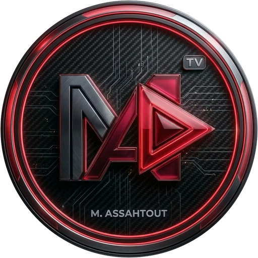

<p align="center">
  
</p>

<h1 align="center">M. ASSAHTOUT TV</h1>

<p align="center">
  <strong>Custom-built Android TV, Google TV &amp; Desktop streaming client</strong><br>
  Engineered with Kotlin, Jetpack Compose for TV, a 60fps optical cinema intro, and a native Rust JNI core.
</p>

<p align="center">
  
  
  
  
  
</p>

---

## Overview

**M. ASSAHTOUT TV** (`m.assahtoute`) is a standalone, performance-focused streaming client designed primarily for living-room televisions (**Android TV** & **Google TV**), alongside a native desktop build for Windows and Linux. Built around zero-lag D-Pad navigation and a custom Media3 + Rust playback pipeline, it streams directly without ads, heavy web views, or tracking.

---

## Key Features

### Flagship Android TV & Google TV Experience
- **Cinema-Grade 60fps Launch Intro**: Frame-accurate optical 3D splash sequence ([`SplashScreen.kt`](android/app/src/main/java/com/streamtube/tv/ui/SplashScreen.kt)) driven by `withFrameNanos`, featuring lens focus pull, 360° specular metallic rim lighting, spectrum ribbon dive-through into `Home`, and custom 48 kHz TV-mastered stereo audio ([`intro_cinema.wav`](android/app/src/main/res/raw/intro_cinema.wav)).
- **100% D-Pad Remote Navigation**: Purpose-built focus handling across Home, Subscriptions, Search, Shorts, Library, Channel/Playlist screens, and Settings with zero focus traps and instant `DPAD_CENTER` / `BACK` responsiveness.
- **4K-Ready TV Assets**: Full-bleed circular adaptive launcher icon (`mipmap-*`), 4K Leanback home banner (`tv_banner.png`), and `FilterQuality.High` sidebar emblem.

### Playback, Engine & Privacy
- **Native Rust Core + Media3 ExoPlayer**: Separate adaptive 4K AV1 / VP9 / H.264 video and audio streams merged seamlessly via `MergingMediaSource` through `libstreamtube_core.so` (`arm64-v8a` & `armeabi-v7a`).
- **Ad-Free & Clean Viewing**: Direct stream extraction with built-in **SponsorBlock**, **DeArrow** titles/thumbnails, and **Return YouTube Dislike** integration.
- **Local-First Persistence**: Subscriptions, watch history, resume positions, playlists, and settings stored locally in SQLite—plus an optional LAN **Companion Web Server** (`:8787` with QR code in Settings) for sending URLs or importing subscriptions/cookies from your phone.
- **Native Desktop App**: Multi-platform Rust + GPUI desktop frontend with libmpv playback, Picture-in-Picture, multi-tab browsing, and automated installers.

---

## Installation (Android TV / Google TV)

Download the latest signed APK (`M-Assahtout-TV.apk`) from the [**GitHub Releases**](https://github.com/meeedsahtoute/M-Assahtout-TV/releases) page.

### Install via ADB
```sh
adb install -r M-Assahtout-TV.apk
```

### Install via TV Downloader / File Manager
1. Copy the release APK URL into Downloader or a TV file manager.
2. Allow **Install unknown apps** for that app in Android TV **Settings → Apps → Security & restrictions** (or **Apps → Special app access**).
3. Open the APK to install **M. ASSAHTOUT TV**.

> Built for both 64-bit (`arm64-v8a`: Chromecast 4K, Google TV Streamer, NVIDIA Shield, Xiaomi TV Box S) and 32-bit (`armeabi-v7a`: Chromecast HD and older TV boxes).

---

## Building From Source

### Android TV APK
Requirements:
- **Rust** (`rustup target add aarch64-linux-android armv7-linux-androideabi`) & `cargo-ndk`
- **Android SDK** (API 35) & **NDK** (`27.2.12479018`)
- **JDK 17** & **Gradle 8.10.2**

```sh
# 1. Build native Rust JNI libraries for ARM64 & ARMv7
cargo ndk -t arm64-v8a -t armeabi-v7a --platform 26 \
  -o android/app/src/main/jniLibs \
  build -p streamtube-android --release

# 2. Build the Android TV APK
cd android
gradle assembleRelease --no-daemon
```

The signed release APK is output to `android/app/build/outputs/apk/release/app-release.apk`.

### Desktop Client (Windows / Linux)
Requirements:
- **Rust 1.85+** (`2024` edition)
- **libmpv** (`third_party/mpv/libmpv-2.dll` on Windows, or `libmpv2` / `mpv-libs` on Linux)

```sh
git clone https://github.com/meeedsahtoute/M-Assahtout-TV.git
cd M-Assahtout-TV
cargo build --release
```

---

## Project Layout

```text
android/                      Android TV / Google TV Jetpack Compose app
  app/src/main/java/com/streamtube/tv/
    ui/                       SplashScreen, AppRoot, NavigationRail, Theme
    ui/screens/               Home, Search, Player, Shorts, Library, Settings
    player/                   Media3 ExoPlayerController & PlaybackService
    server/                   Phone-to-TV LAN CompanionServer (:8787)
    core/                     JNI NativeBridge & DTO models
crates/
  streamtube-core/            Shared Rust InnerTube, SQLite, SponsorBlock, DeArrow core
  streamtube-android/         JNI bindings compiled to libstreamtube_core.so
src/                          Native Rust + GPUI desktop application
.github/workflows/            Automated Android TV APK, Desktop & Release pipelines
```

---

## Author & Maintainer

Developed and maintained by **Mohammed Assahtout** (`m.assahtoute`).

## License

This project is licensed under the [MIT License](LICENSE).
